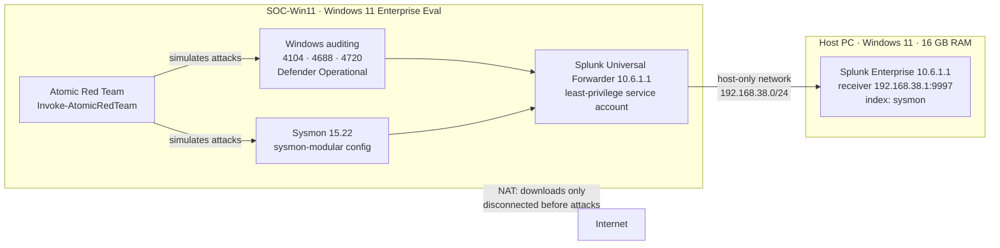

# SOC Detection Lab

**Author:** Satwika Maddukuri · M.S. Information Systems, Northeastern University (December 2026)
**Repository:** github.com/ancientbrain/soc-detection-lab

A home SOC lab built to practise the full detection-engineering cycle: instrument an endpoint, simulate adversary techniques, write and tune detections against real baseline data, and manage detections as code. Every phase is documented with evidence, honest failure cases, and lessons learned.

---

## Architecture



---

## What I Built

### Phase 1 · Lab setup

- Windows 11 Enterprise Evaluation VM in VMware Workstation Pro, isolated on a host-only network
- Sysmon 15.22 with the [sysmon-modular](https://github.com/olafhartong/sysmon-modular) default config (SHA256 verified)
- Splunk Enterprise 10.6.1.1 on the host with a dedicated `sysmon` index
- Universal Forwarder collecting Sysmon, Security, PowerShell Operational, and Windows Defender Operational logs
- All configs version-controlled from day one

**Notable challenge:** the forwarder's least-privilege service account (`NT SERVICE\SplunkForwarder`) lacked read access to the Sysmon event channel. Rather than run the forwarder as LocalSystem, a single read-only ACE was appended to the channel's SDDL.

### Phase 2 · Adversary emulation and detection

Six MITRE ATT&CK techniques were simulated with [Atomic Red Team](https://github.com/redcanaryco/invoke-atomicredteam). Each technique was investigated across log sources, and a detection was written, tuned against the baseline, and saved as a Splunk alert.

| Technique | Test | Data source | TP | FP | Alert severity |
|---|---|---|---|---|---|
| T1059.001 · PowerShell | Encoded command (`-e` flag) | Sysmon 1 | 1 | 0 | High |
| T1003.001 · LSASS dump | comsvcs.dll MiniDump | Security 4688 + Sysmon 1 | 2 | 0 | Critical |
| T1053.005 · Scheduled task | `schtasks /create` | Sysmon 1 | 1 | 0 | High |
| T1547.001 · Run key | `reg.exe` → CurrentVersion\Run | Sysmon 13 | 1 | 0 | High |
| T1136.001 · Local account | `net user /add` | Security 4720 | 1 | 0 | High |
| T1087.001 · Account discovery | `net user` / `net localgroup` | Sysmon 1 | 10 | 0 | Medium |

**Bonus — T1562.001 · Impair Defenses:** turning off Defender real-time protection was captured as Defender Event 5001 and forwarded to Splunk.

**Key findings:**

1. **Detection gap in a common rule.** The plan's original encoded-PowerShell search used `CommandLine="*-enc*"`. PowerShell also accepts `-e`, `-en`, and `-ec`. The textbook search returned 0 results against the actual attack; the improved regex-based detection returned 1. Zero false positives across 51,000+ baseline events.

2. **Prevention without visibility.** The first LSASS dump attempt was blocked by Defender (`Trojan:Win32/RundllLolBin.AF`). Sysmon's filtered config missed the attempt; Security 4688 caught it. Without Defender's operational log in the SIEM, an analyst would not know an attack was attempted.

3. **Two independent prevention layers.** With Defender's real-time protection disabled, `rundll32.exe` launched and targeted LSASS, but no dump was created because **LSA protection** (`RunAsPPL=2`) was also active. The detection fired on both attempts regardless of which layer stopped the dump.

4. **Detection tuning from real baseline data.** The Run key detection initially returned 16 false positives (Microsoft Edge registering its auto-launch key). Filtering on the writing process and account reduced it to 1 true positive with 0 false positives.

### Phase 3 · Detection-as-Code

Four detections were rewritten as [Sigma](https://github.com/SigmaHQ/sigma) rules in `rules/` and converted to Splunk SPL with sigma-cli 4.0.1 (Splunk backend, sysmon pipeline).

```bash
sigma convert -t splunk -p sysmon rules/T1059.001_powershell_encoded_command.yml
```

| Rule | Sigma-generated SPL | Validated |
|---|---|---|
| T1059.001 | `EventID=1 \| regex CommandLine=...` | ✅ 1 TP |
| T1053.005 | `EventID=1 Image="*\\schtasks.exe" CommandLine="*/create*"` | ✅ 1 TP |
| T1547.001 | `EventID=13 TargetObject IN (...) NOT (...)` | ✅ 1 TP |
| T1136.001 | `EventID=4720 NOT SubjectUserName IN (...)` | ⚠️ Field not extracted in this config; `EventCode=4720` works |

**Limitation:** the sysmon pipeline maps field names correctly for Sysmon events but `SubjectUserName` is not extracted from Security log events in this Splunk configuration. The Sigma rule is correct; the gap is in the add-on's field extraction.

---

## Repository Structure

```
soc-detection-lab/
├── configs/
│   ├── splunk/
│   │   ├── forwarder/      # inputs.conf, outputs.conf
│   │   └── indexer/        # indexes.conf, inputs.conf
│   └── sysmon/
│       └── sysmonconfig.xml  # sysmon-modular default (SHA256 verified)
├── detections/
│   └── spl/                # 7 Splunk detection searches
├── docs/
│   └── progress-log.md     # dated session log
├── reports/
│   └── project-report.md   # graduate-level technical report
├── rules/                  # 4 Sigma rules
└── screenshots/
```

---

## Tools and Versions

| Tool | Version | Role |
|---|---|---|
| VMware Workstation Pro | 26.0.1 | Hypervisor |
| Windows 11 Enterprise Evaluation | Build 26300 | Victim endpoint |
| Sysmon | 15.22 | Endpoint telemetry |
| sysmon-modular | configs-a45dedb13a43 | Sysmon configuration |
| Splunk Enterprise | 10.6.1.1 | SIEM |
| Splunk Universal Forwarder | 10.6.1.1 | Log shipping |
| Invoke-AtomicRedTeam | master branch | Adversary emulation |
| sigma-cli | 4.0.1 | Sigma-to-SPL conversion |
| pysigma-backend-splunk | 3.0.0 | Splunk backend for sigma-cli |

---

## What I Learned

- **Telemetry pipeline engineering.** Deploying and troubleshooting a forwarder-to-SIEM pipeline end to end, including permissions, field extraction, and clock synchronisation.
- **Detection engineering with real data.** Writing detections against a baseline exposes false positives that theoretical rules miss. Tuning from evidence is different from tuning from intuition.
- **Defense in depth in practice.** Two independent prevention layers (Defender and LSA protection) each stopped the same credential-dump attack, and the detection fired regardless of which layer acted first.
- **Sigma portability.** A rule written once converts to multiple SIEM platforms. The sysmon pipeline automates most of the field-mapping work, though Security log field extraction varies by configuration.

---

## Full Technical Report

A graduate-level technical report covering design decisions, implementation evidence, challenges and resolutions, and evaluation results is in [`reports/project-report.md`](reports/project-report.md).
