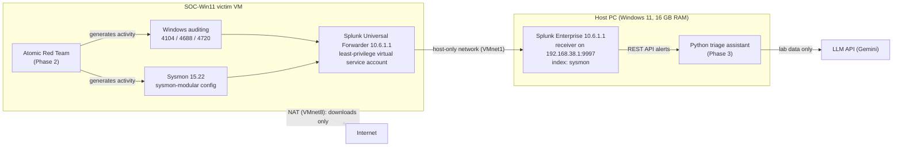

# AI-Assisted SOC Detection Lab: Design, Implementation, and Evaluation of an Endpoint Detection Pipeline with LLM-Assisted Alert Triage

**Author:** Satwika Maddukuri
**Program:** M.S. Information Systems, Northeastern University (expected December 2026)
**Repository:** github.com/ancientbrain/ai-soc-detection-lab
**Document status:** Living report, version 0.4
**Last updated:** November 6, 2026 (end of Phase 1, Day 4)

> This report is updated at the end of each work session. Sections marked *[Planned]* describe work that has not yet been carried out; they will be replaced with methods, evidence, and results as the project progresses.

---

## Abstract

*[Provisional; to be finalized at project completion.]*

Security Operations Centers (SOCs) depend on high-fidelity endpoint telemetry, well-engineered detections, and efficient alert triage. This project builds a self-contained SOC laboratory to study all three. A Windows 11 victim host is instrumented with Microsoft Sysinternals Sysmon and native Windows auditing, and its telemetry is forwarded to Splunk Enterprise. Adversary behavior is emulated with Atomic Red Team, and detections are written against the resulting data and mapped to MITRE ATT&CK. The project then evaluates a large language model (LLM) as a triage assistant, measuring its accuracy against the author's manual analysis and documenting failure modes such as hallucination. Finally, detections are re-expressed as vendor-neutral Sigma rules and managed as code. As of this version, the full telemetry pipeline (endpoint instrumentation, forwarding, and SIEM ingestion) is deployed and verified end to end; detection, evaluation, and results are pending.

---

## 1. Introduction

### 1.1 Motivation

Entry-level SOC work centers on three skills: understanding what telemetry an endpoint produces, writing searches that reliably separate malicious from benign activity, and triaging alerts quickly and accurately. LLMs are increasingly proposed as triage aids, but their reliability on security data is not well established, and unverified AI output in a SOC carries real operational risk. A controlled lab allows each of these elements to be built, tested, and measured end to end, with known ground truth for every simulated attack.

### 1.2 Objectives

1. Build an isolated, reproducible lab producing rich Windows endpoint telemetry.
2. Emulate a defined set of MITRE ATT&CK techniques and write detections that identify each one.
3. Document an investigation of a multi-stage attack chain in a professional incident report.
4. Design an LLM-based triage assistant with structured prompting and mandatory human review, and evaluate its accuracy against manual analysis.
5. Re-implement detections as Sigma rules, convert them to Splunk SPL, and manage them under version control (Detection-as-Code).

### 1.3 Scope

The lab consists of a single Windows 11 victim virtual machine and a Splunk Enterprise instance on the host. All adversary emulation occurs inside the virtual machine. Only synthetic lab data is processed by the LLM. Network-based detection, multi-host lateral movement, and production deployment are out of scope.

### 1.4 Schedule

The project follows a 22-day plan at roughly two hours per day.

| Phase | Focus | Planned dates | Status |
|---|---|---|---|
| 1 | Build the lab | Nov 3 – Nov 7, 2026 | Complete (Nov 6; Day 5 available as buffer) |
| 2 | Attack, detect, investigate | Nov 8 – Nov 12 | Not started |
| 3 | AI-assisted triage | Nov 13 – Nov 17 | Not started |
| 4 | Detection-as-Code and polish | Nov 18 – Nov 21 | Not started |
| Buffer | Contingency | Nov 22 – Nov 24 | Unused |

---

## 2. Background

### 2.1 Endpoint telemetry

Default Windows logging records limited detail about process behavior. **Sysmon** is a free Microsoft Sysinternals system service that writes detailed events to the Windows event log, including process creation with full command lines and file hashes (Event ID 1), network connections (3), process access (10), registry modifications (12–14), and DNS queries (22). Sysmon's value depends heavily on its configuration, which determines which events are recorded and which are filtered as noise.

Two native Windows sources complement Sysmon. **PowerShell Script Block Logging** (Event ID 4104) records the content of script blocks as PowerShell executes them, after any obfuscation such as Base64 encoding has been decoded. **Security log auditing** records process creation (4688), which can include the command line when enabled, and account management events such as user creation (4720).

### 2.2 MITRE ATT&CK

MITRE ATT&CK is a publicly maintained knowledge base of adversary tactics and techniques derived from real-world observations. It provides a common vocabulary for describing attacker behavior and for measuring detection coverage. This project maps every simulated technique and every detection to an ATT&CK technique ID.

### 2.3 Adversary emulation

**Atomic Red Team** is an open-source library of small, focused tests, each mapped to an ATT&CK technique, that reproduce attacker behavior in a controlled way. Because the timing and content of each test are known, the resulting telemetry serves as ground truth for detection development and for evaluating automated triage.

### 2.4 Detection-as-Code and Sigma

Detection-as-Code applies software engineering practices (version control, review, and automated testing) to detection logic. **Sigma** is a vendor-neutral, YAML-based rule format for log detections. Rules written once in Sigma can be converted to query languages such as Splunk SPL with the pySigma toolchain, making detections portable across SIEM platforms.

### 2.5 LLMs in alert triage

LLMs can summarize alerts, suggest likely techniques, and recommend next steps, potentially reducing analyst workload. Known risks include hallucination (asserting facts not supported by the input), overconfidence, and sensitivity to prompt wording. Any evaluation must therefore compare model output against verified ground truth and keep a human analyst responsible for every decision.

---

## 3. Lab Architecture

### 3.1 Overview



### 3.2 Components

| Component | Version / detail | Location | Role |
|---|---|---|---|
| Host operating system | Windows 11, 16 GB RAM | Host | Runs the hypervisor, Splunk, and analysis tooling |
| VMware Workstation Pro | 26.0.1 | Host | Hypervisor |
| Windows 11 Enterprise Evaluation | Build 26300.9457 (90-day evaluation) | VM `SOC-Win11` | Victim endpoint |
| Sysmon | 15.22 | VM | Primary endpoint telemetry |
| sysmon-modular config | Release `configs-a45dedb13a43`, default balanced config | VM | Defines Sysmon event filtering |
| Splunk Enterprise | 10.6.1.1 (60-day Enterprise trial, convertible to Free license) | Host | SIEM: indexing, search, alerting |
| Splunk Add-on for Sysmon | 5.0.1 (`Splunk_TA_microsoft_sysmon`) | Host | Field extraction for Sysmon events |
| Splunk Add-on for Microsoft Windows | 12.0.0 (`Splunk_TA_windows`) | Host | Field extraction for Security and PowerShell events |
| Splunk Universal Forwarder | 10.6.1.1 (build b2ae2962645c, matching the receiver) | VM | Log shipping |
| Atomic Red Team | *[Pending, Phase 2]* | VM | Adversary emulation |
| Gemini API | *[Pending, Phase 3]* | External | LLM for triage experiments |
| sigma-cli / pySigma | *[Pending, Phase 4]* | Host | Sigma-to-SPL conversion |

### 3.3 Virtual machine specification

| Resource | Allocation |
|---|---|
| Memory | 4 GB |
| Processors | 2 |
| Disk | 80 GB NVMe, dynamically allocated, split files |
| Firmware | UEFI with virtual TPM 2.0 |
| Encryption | TPM-related files only (`.nvram`, `.vmss`, `.vmem`, `.vmx`, `.vmsn`) |
| Network adapters | Adapter 1: NAT; Adapter 2: host-only |
| Removed devices | Sound card |

### 3.4 Network design

| Network | Subnet | Host address | VM address | Purpose |
|---|---|---|---|---|
| VMnet8 (NAT) | 192.168.23.0/24 | — (gateway 192.168.23.2) | 192.168.23.133 (DHCP) | Internet access for tool downloads |
| VMnet1 (host-only) | 192.168.38.0/24 | 192.168.38.1 | 192.168.38.128 (DHCP) | Private telemetry path to Splunk |

The dual-adapter design separates two needs. Tool installation requires internet access, while telemetry should travel only over a private link. Before adversary emulation begins, the NAT adapter will be disconnected so that the victim can reach only the host.

### 3.5 Design decisions

| Decision | Alternatives considered | Rationale |
|---|---|---|
| VMware Workstation Pro as hypervisor | VirtualBox (original plan) | Already installed and free for personal use; avoids running two hypervisors with conflicting drivers; full snapshot support. |
| Splunk on the host rather than in a second VM | Dedicated Splunk VM | With 16 GB of host RAM, a second VM would compete for memory; a host install is lighter and simpler to reach over the host-only network. |
| Windows 11 Enterprise Evaluation | Windows 10 | Current, supported platform representative of enterprise endpoints; free for testing purposes. |
| 80 GB virtual disk | 50 GB (original plan) | Windows 11 requires at least 64 GB of storage; dynamic allocation means unused space costs nothing. |
| TPM-only encryption | Full VM encryption | Satisfies the Windows 11 TPM requirement without full-disk encryption overhead. |
| VM stored at `C:\VMs\` | Default OneDrive location | Cloud sync of active VM files risks corruption and file locking, and would upload attack-lab artifacts to cloud storage. |
| sysmon-modular configuration | SwiftOnSecurity sysmon-config | Rules are annotated with ATT&CK technique IDs, and the default configuration logs process access to `lsass.exe`, which credential-dumping detection requires. |

---

## 4. Implementation

### 4.1 Phase 1: Building the lab

#### 4.1.1 Repository initialization (Day 0, November 2)

A private GitHub repository was created with a structure mirroring the project phases (`configs/`, `detections/`, `rules/`, `triage/`, `reports/`, `docs/`, `screenshots/`). A `.gitignore` excludes secrets (`.env`, key files), virtual machine artifacts (`.vmdk`, `.vmx`, `.iso`), raw event log exports (`.evtx`), and Python build files. Commits use a GitHub no-reply address so that no personal email address is published when the repository is made public. A progress log (`docs/progress-log.md`) records each session.

#### 4.1.2 Victim virtual machine (Day 1, November 4)

The VM was created in VMware Workstation Pro with the specification in Section 3.3. Windows 11 Enterprise Evaluation was installed from an ISO downloaded directly from the Microsoft Evaluation Center. During setup, the "I don't have internet" path was used to create a local account rather than a Microsoft account, keeping the lab free of personal cloud identities. VMware Tools was installed for display and input integration. After networking was repaired (Section 6), Windows Update was applied and a baseline snapshot, **"Clean install,"** was taken.

**Verification evidence**

| Check | Expected | Observed |
|---|---|---|
| NAT address | 192.168.23.x | 192.168.23.133, gateway 192.168.23.2 |
| Host-only address | 192.168.38.x | 192.168.38.128 |
| Internet reachability | `TcpTestSucceeded: True` to 8.8.8.8:53 | True (interface Ethernet0) |
| Baseline snapshot | Present in Snapshot Manager | "Clean install" present |

#### 4.1.3 Endpoint instrumentation (Day 2, November 4)

**Sysmon.** Sysmon was downloaded from the official Sysinternals distribution point. The sysmon-modular repository no longer contains a prebuilt `sysmonconfig.xml`, so the configuration was located among the release assets through the GitHub API (Section 6). Its integrity was verified against the publisher's SHA256SUMS file before installation:

```
SHA256 (published):  64bec37ba849c5f2934a55d2a29e7ddfae46a30d56f7f2908d1f8a454898797e
SHA256 (computed):   64bec37ba849c5f2934a55d2a29e7ddfae46a30d56f7f2908d1f8a454898797e
```

Before installation, the configuration was inspected to confirm that it contains `ProcessAccess` rules targeting `C:\Windows\system32\lsass.exe`, annotated `technique_id=T1003, technique_name=OS Credential Dumping`. Sysmon was installed with:

```powershell
.\Sysmon64.exe -accepteula -i sysmonconfig.xml
```

**Native Windows logging.** The following settings were applied through the registry keys that Group Policy writes, which is functionally equivalent to configuring them in `gpedit.msc`:

| Setting | Mechanism | Event produced |
|---|---|---|
| PowerShell Script Block Logging | `HKLM\SOFTWARE\Policies\Microsoft\Windows\PowerShell\ScriptBlockLogging\EnableScriptBlockLogging = 1` | 4104 |
| Command line in process creation events | `HKLM\SOFTWARE\Microsoft\Windows\CurrentVersion\Policies\System\Audit\ProcessCreationIncludeCmdLine_Enabled = 1` | 4688 (with command line) |
| Audit Process Creation | `auditpol /set /subcategory:"Process Creation" /success:enable` | 4688 |
| Audit User Account Management | `auditpol /set /subcategory:"User Account Management" /success:enable /failure:enable` | 4720 and related |

**Verification evidence**

| Check | Observed |
|---|---|
| Sysmon service | `Sysmon64` running |
| Sysmon events generated | Event IDs 3, 13, and 22 observed within minutes of installation |
| Script block logging | 4104 events generated by a new PowerShell session |
| Process creation command lines | 4688 event with a populated `Process Command Line` field |
| Audit policy | Process Creation: Success; User Account Management: Success and Failure |

An observation worth recording: a 4104 event existed from before script block logging was enabled. Windows logs script blocks it classifies as suspicious even without the policy, but enabling the policy is necessary for complete coverage.

The 4688 evidence also illustrates a triage-relevant field. `TokenElevationTypeLimited (3)` indicates the process ran without administrative privileges, whereas Type 2 (elevated) would indicate administrative execution, a useful signal when assessing an alert's severity.

A second snapshot, **"Sysmon + logging,"** was taken, and the verified configuration was committed to `configs/sysmon/sysmonconfig.xml`, with a matching hash confirmed on the host.

#### 4.1.4 SIEM deployment (Day 3, November 5)

Splunk Enterprise 10.6.1.1 was installed on the host from the official Windows MSI with default options (installed to `C:\Program Files\Splunk`, running as a Windows service). The 60-day Enterprise trial converts to the Free license (500 MB/day), which comfortably exceeds the lab's expected volume. Configuration then proceeded as follows:

1. **Index.** An events index named `sysmon` was created to hold all lab telemetry. Every detection will be scoped to `index=sysmon`.
2. **Receiving.** A receiving input was enabled on TCP 9997, the conventional port for Splunk-to-Splunk forwarding.
3. **Host firewall.** An inbound rule was created that allows TCP 9997 **only** from the host-only subnet:

   ```powershell
   New-NetFirewallRule -DisplayName "Splunk receiver 9997 (lab host-only)" -Direction Inbound -Protocol TCP -LocalPort 9997 -RemoteAddress 192.168.38.0/24 -Action Allow -Profile Any
   ```

   This applies least privilege: the home network and other interfaces cannot reach the receiver.
4. **Add-ons.** The Splunk Add-on for Sysmon (5.0.1) and the Splunk Add-on for Microsoft Windows (12.0.0) were installed to provide search-time field extraction (for example `CommandLine`, `Image`, `TargetImage`). Because Splunk Web's in-product app browser returned errors (Section 6), both packages were downloaded from Splunkbase, their provenance was checked (official site, publisher Splunk), and they were installed with the Splunk CLI:

   ```powershell
   & "C:\Program Files\Splunk\bin\splunk.exe" install app <package>
   & "C:\Program Files\Splunk\bin\splunk.exe" restart
   ```

**Verification evidence**

| Check | Expected | Observed |
|---|---|---|
| Receiver listening | TCP 9997 in LISTENING state | `0.0.0.0:9997 LISTENING` |
| Firewall rule | Enabled, inbound, allow | `Splunk receiver 9997 (lab host-only)`: True, Inbound, Allow |
| Reachability from VM | `TcpTestSucceeded: True` from a 192.168.38.x source | True; source 192.168.38.128 via the VM's host-only adapter |
| Add-ons | Installed and enabled | `Splunk_TA_microsoft_sysmon` and `Splunk_TA_windows`: ENABLED |

The receiver-side Splunk configuration (`indexes.conf`, `inputs.conf`) is stored in `configs/splunk/indexer/`.

#### 4.1.5 Forwarder deployment and end-to-end validation (Day 4, November 6)

**Installation.** The Splunk Universal Forwarder 10.6.1.1 was downloaded on the host (keeping the author's Splunk account off the victim machine) and copied into the VM. Its build identifier (`b2ae2962645c`) matches the receiver, avoiding version-mismatch issues. The installer was run with default options, which create a dedicated local forwarder administrator account and run the service as the low-privilege virtual account `NT SERVICE\SplunkForwarder`. The receiving indexer was set to `192.168.38.1:9997`, producing this `outputs.conf`:

```ini
[tcpout]
defaultGroup = default-autolb-group

[tcpout:default-autolb-group]
server = 192.168.38.1:9997

[tcpout-server://192.168.38.1:9997]
```

**Inputs.** Collection was defined in `etc\system\local\inputs.conf`. Sysmon events are sent in XML form (`renderXml = true`), the format the Sysmon add-on expects:

```ini
[WinEventLog://Microsoft-Windows-Sysmon/Operational]
index = sysmon
renderXml = true
disabled = 0

[WinEventLog://Security]
index = sysmon
disabled = 0

[WinEventLog://Microsoft-Windows-PowerShell/Operational]
index = sysmon
disabled = 0
```

**Fault diagnosis: missing Sysmon telemetry.** After the forwarder restarted, `splunk list forward-server` reported an active connection, and Security and PowerShell events arrived in Splunk, but Sysmon events did not. A search across all indexes (`index=* source=*Sysmon*`) returned nothing, ruling out misrouting. The forwarder's internal log (`var\log\splunk\splunkd.log`) showed the cause:

```
ERROR ExecProcessor ... splunk-winevtlog - WinEventLogChannel::init: Init failed,
unable to subscribe to Windows Event Log channel 'Microsoft-Windows-Sysmon/Operational': errorCode=5
```

Error code 5 is Windows `ERROR_ACCESS_DENIED`. The Sysmon channel's access control list, read with `wevtutil gl`, granted read access to SYSTEM, Administrators, Backup Operators, Server Operators, and Event Log Readers, but not to the forwarder's virtual account:

```
O:BAG:SYD:(A;;0xf0007;;;SY)(A;;0x7;;;BA)(A;;0x1;;;BO)(A;;0x1;;;SO)(A;;0x1;;;S-1-5-32-573)
```

Two remediations were considered: running the forwarder as LocalSystem, or granting the existing account read-only access to this one channel. The second preserves least privilege and was chosen. The account's SID was resolved and a single read-only access control entry (`0x1`) was appended:

```powershell
wevtutil sl Microsoft-Windows-Sysmon/Operational "/ca:O:BAG:SYD:(A;;0xf0007;;;SY)(A;;0x7;;;BA)(A;;0x1;;;BO)(A;;0x1;;;SO)(A;;0x1;;;S-1-5-32-573)(A;;0x1;;;S-1-5-80-972488765-139171986-783781252-3188962990-3730692313)"
```

After the forwarder restarted, no new access errors appeared and Sysmon events began arriving in Splunk. Whether a Sysmon reinstall or configuration update resets this channel ACL has not been tested; it is the first item to check if Sysmon ingestion stops after such a change.

**Clock alignment.** The forwarder log revealed that the VM's time zone was Pacific (UTC−08:00). It was changed to Eastern (`Set-TimeZone -Id "Eastern Standard Time"`) to match the analyst's local time and simplify attack timelines. Splunk stores event times internally in UTC, so data already ingested was unaffected.

**Verification evidence**

| Check | Expected | Observed |
|---|---|---|
| Forwarder service | Running | `SplunkForwarder` running as `NT SERVICE\SplunkForwarder` |
| Forwarding connection | Active | `Active forwards: 192.168.38.1:9997`; no inactive forwards |
| Sources in Splunk | Sysmon, Security, PowerShell | All three present after the ACL fix |
| Event volume | Non-zero | 20,495 events across 42 distinct event codes (Nov 5, 4:00 PM to Nov 6, 4:44 PM) |

A **"Logging ready"** snapshot was taken. It is the restore point for all adversary emulation in Phase 2.

#### 4.1.6 Baseline telemetry profile

The pre-attack event distribution, the 14 most frequent of 42 event codes, establishes a benign baseline against which emulated attacks will be compared:

| Event code | Source | Meaning | Count |
|---|---|---|---|
| 4907 | Security | Auditing settings on an object were changed | 9,849 |
| 11 | Sysmon | File created | 4,399 |
| 2 | Sysmon | File creation time changed | 2,113 |
| 13 | Sysmon | Registry value set | 1,413 |
| 4688 | Security | Process created | 818 |
| 7 | Sysmon | Image (DLL) loaded | 380 |
| 3 | Sysmon | Network connection | 353 |
| 12 | Sysmon | Registry object created or deleted | 289 |
| 10 | Sysmon | Process accessed | 196 |
| 4104 | PowerShell | Script block logged | 131 |
| 4624 | Security | Successful logon | 105 |
| 4672 | Security | Special privileges assigned to new logon | 99 |
| 1 | Sysmon | Process created | 95 |
| 5379 | Security | Credential Manager credentials read | 54 |

Three observations from the baseline shape the detection work ahead:

1. **4907 dominates the volume** (about 48% of events). It most likely reflects Windows servicing activity after updates. It has little detection value here and is a candidate for filtering if volume ever becomes a concern.
2. **Sysmon Event 1 (95) is far lower than Security 4688 (818)** because the sysmon-modular configuration filters out known-benign process launches, while 4688 records every process. Sysmon Event 1 is therefore the higher-signal source for process-based detections.
3. **Sysmon Event 10 already appears 196 times without any attack.** Benign processes access LSASS routinely, so the credential-dumping detection (T1003.001) must be tuned against this baseline to avoid false positives.

### 4.2 Phase 2: Adversary emulation and detection *[Planned]*

| ATT&CK ID | Technique | Primary data source | Detection status |
|---|---|---|---|
| T1059.001 | PowerShell (encoded commands) | Sysmon 1, PowerShell 4104 | Not started |
| T1003.001 | LSASS memory credential dumping | Sysmon 10 | Not started |
| T1053.005 | Scheduled task | Sysmon 1 | Not started |
| T1547.001 | Registry Run keys | Sysmon 13 | Not started |
| T1136.001 | Create local account | Security 4720 | Not started |
| T1087.001 | Local account discovery | Sysmon 1 | Not started |

For each technique this section will record the Atomic test executed and its timestamp, the detection logic, whether the detection fired, and false-positive observations from baseline activity. A dashboard and an incident report for the chain PowerShell → credential dumping → persistence will follow.

### 4.3 Phase 3: LLM-assisted triage *[Planned]*

**Design.** A Python client will retrieve triggered alerts through the Splunk REST API and submit each one to the LLM with a structured prompt that specifies context, objective, constraints (use only the provided data, answer "insufficient data" when uncertain), and a JSON output schema (summary, likely ATT&CK technique, severity with rationale, recommended next steps, confidence). No alert is actioned without analyst approval.

**Evaluation method.** Each model response will be graded against the author's manual analysis on a four-level rubric: *correct*, *partially correct*, *wrong*, or *hallucinated* (asserting details absent from the input). Results will be reported per technique and in aggregate, with technique-mapping accuracy measured separately. Prompt revisions and their effects will be documented.

### 4.4 Phase 4: Detection-as-Code *[Planned]*

Four to six detections will be rewritten as Sigma rules in `rules/`, converted to SPL with sigma-cli using the Splunk backend, and re-validated against the original Atomic test data. Optionally, a GitHub Actions workflow will validate rule syntax on every push.

---

## 5. Telemetry Coverage

| Source | Event ID | Captures | Relevant ATT&CK techniques | Status |
|---|---|---|---|---|
| Sysmon | 1 | Process creation, command line, hashes, parent | T1059.001, T1053.005, T1087.001 | Ingested |
| Sysmon | 3 | Network connections | Command and control, exfiltration | Ingested |
| Sysmon | 10 | Process access (including LSASS) | T1003.001 | Ingested (benign baseline present) |
| Sysmon | 13 | Registry value set | T1547.001 | Ingested |
| Sysmon | 22 | DNS queries | Command and control | Verified locally |
| PowerShell | 4104 | Decoded script block content | T1059.001 | Ingested |
| Security | 4688 | Process creation with command line | Broad execution coverage | Ingested |
| Security | 4720 | User account created | T1136.001 | Auditing enabled |

"Ingested" means events were observed in Splunk (`index=sysmon`). "Verified locally" means events were seen in the VM's event log but did not appear among the most frequent codes in Splunk. "Auditing enabled" means the event will first be produced during adversary emulation.

---

## 6. Challenges and Resolutions

| # | Issue | Symptom | Root cause | Resolution | Lesson |
|---|---|---|---|---|---|
| 1 | Git authentication failure | `Invalid username or token. Password authentication is not supported` | A stale saved GitHub credential on the host | Cleared it with `git credential reject` and re-authenticated through Git Credential Manager's browser flow | Check for cached credentials before assuming an account problem. |
| 2 | VM default path inside OneDrive | Wizard defaulted to `OneDrive\Documents\Virtual Machines` | VMware default location | Relocated to `C:\VMs\SOC-Win11` | Review defaults; cloud sync is unsuitable for VM disks and attack-lab artifacts. |
| 3 | No network addresses in VM | Both adapters had APIPA addresses (169.254.x.x); no internet | The host's VMware DHCP service (`VMnetDHCP`) was stopped despite automatic start | Started the service and renewed the leases (`ipconfig /release`, `/renew`) | A 169.254.x.x address always means DHCP did not answer; check the DHCP source first. |
| 4 | Sysmon config download returned 404 | Raw GitHub URL for `sysmonconfig.xml` not found | sysmon-modular no longer commits the generated config to the repository | Queried the GitHub API, found the config among the release assets, and verified it against SHA256SUMS | Tutorials go stale; consult the authoritative source and verify integrity. |
| 5 | Push rejected | `remote: fatal error in commit_refs` | GitHub server-side error | Commit preserved locally; push succeeded unchanged the next day (Nov 5) once the service recovered | Distinguish server-side from client-side failures before troubleshooting locally; Git's local-first design means a failed push never loses work. |
| 6 | Splunk Web app browser unavailable | "Page not found" and generic error pages when opening the app browser and the Manage Apps URL | Not fully diagnosed; a Splunk Web issue in this 10.6.1.1 installation | Installed the add-ons from Splunkbase packages with the Splunk CLI | Keep a CLI fallback; file-based installation is also standard on production SIEMs without internet access. |
| 7 | Browser warning on add-on packages | `.tgz` downloads flagged as potentially harmful | Generic browser heuristic for uncommon archive types | Confirmed the official source and publisher before keeping the files | Base trust decisions on provenance, not on the warning alone. |
| 8 | CLI command appeared to hang | `splunk display app \| Select-String` printed nothing for minutes | The CLI's login prompt was hidden by the output filter | Authenticated first with `splunk login`, then reran the command | Authenticate before piping interactive CLI output. |
| 9 | Verification run on the wrong machine | Connectivity tests showed the host's own addresses | Commands entered in the host terminal instead of the VM | Reran in the VM after checking the prompt (`satu7` = host, `SOC-WIN11` = VM) | Always confirm which machine a terminal belongs to; critical once attack simulations begin. |
| 10 | Write to forwarder configuration denied | `Out-File: Access to the path ... inputs.conf is denied` | Terminal not elevated | Reopened Terminal as Administrator and confirmed the role before writing | Changes under `Program Files` require elevation; verify the role rather than assuming it. |
| 11 | Sysmon events missing from Splunk | Security and PowerShell arrived; Sysmon absent from all indexes | Forwarder virtual account lacked read access to the Sysmon channel (`errorCode=5`) | Appended a read-only ACE for the account's SID to the channel SDDL (Section 4.1.5) | Least-privilege agents need explicit access to each protected log source; check the agent's own logs first. |

---

## 7. Security, Safety, and Ethical Controls

1. **Isolation.** Adversary emulation runs only inside the VM. The NAT adapter will be disconnected before testing, leaving only the host-only link.
2. **Least-privilege network access.** The host firewall admits TCP 9997 only from the host-only subnet 192.168.38.0/24.
   **Least-privilege agent.** The forwarder runs as a virtual service account with read-only access to exactly the channels it collects, rather than as LocalSystem.
3. **Recoverability.** Snapshots are taken before every change and every attack test; current snapshots are "Clean install," "Sysmon + logging," and "Logging ready."
4. **Hardware separation.** No host USB devices (webcam, fingerprint reader, storage) are passed through to the VM.
5. **Supply-chain integrity.** Software is obtained only from official sources (Microsoft, Sysinternals, Splunk and Splunkbase, the original project repositories), and published hashes are verified where available.
6. **Data handling.** Only synthetic lab telemetry is ever sent to the LLM; no real organizational or personal data enters the lab.
7. **Secrets hygiene.** API keys will be stored in environment variables and excluded by `.gitignore`; the repository stays private until the core project is complete.
8. **Licensing.** Windows 11 Enterprise is used under Microsoft's evaluation terms for non-production testing.
9. **Human oversight.** The triage assistant is advisory; every recommendation requires analyst approval.

---

## 8. Results

*[Pending; to be completed in Phases 2–4.]* Planned contents: detection outcomes per technique, baseline false-positive observations, LLM triage accuracy by rubric category, representative failure cases, and Sigma conversion fidelity.

---

## 9. Limitations and Future Work

*[Partially provisional.]* Known limitations include a single-host environment with no lateral movement or domain infrastructure; Atomic tests that approximate but do not fully reproduce real adversary tradecraft; and a small alert sample for LLM evaluation, which limits statistical generalization. Splunk runs with its default self-signed certificates, and CLI server-certificate hostname validation is disabled in this installation; both are acceptable for a local-only lab but would be hardened in production. The host runs Windows 11, while Splunk's download page for 10.6.1.1 listed Windows 10 and Windows Server 2019/2022/2025, so the host OS may fall outside the officially listed platforms; this has no practical effect in the lab. Future work may include an Active Directory domain, network sensors, and detection of prompt-injection attempts against a lab LLM application.

---

## 10. Conclusion

*[Pending.]*

---

## References

1. Microsoft Sysinternals. *Sysmon*. https://learn.microsoft.com/sysinternals/downloads/sysmon
2. Hartong, O. *sysmon-modular*. https://github.com/olafhartong/sysmon-modular
3. The MITRE Corporation. *MITRE ATT&CK*. https://attack.mitre.org
4. Red Canary. *Atomic Red Team*. https://github.com/redcanaryco/atomic-red-team
5. SigmaHQ. *Sigma: Generic Signature Format for SIEM Systems*. https://github.com/SigmaHQ/sigma
6. Microsoft. *Windows 11 Enterprise Evaluation*. https://www.microsoft.com/evalcenter/evaluate-windows-11-enterprise

---

## Appendix A: Session Timeline

| Date | Session | Outcome |
|---|---|---|
| Nov 2, 2026 | Day 0: Preparation | Hardware confirmed (16 GB RAM, more than 200 GB free); VMware networks verified; repository initialized |
| Nov 4, 2026 | Day 1: Victim VM | VM built, networking repaired, updated, "Clean install" snapshot |
| Nov 4, 2026 | Day 2: Instrumentation | Sysmon and Windows auditing deployed and verified; "Sysmon + logging" snapshot |
| Nov 5, 2026 | Day 3: SIEM | Splunk Enterprise 10.6.1.1 installed; `sysmon` index; receiving on 9997 with a host-only firewall rule; Sysmon and Windows add-ons installed via CLI |
| Nov 6, 2026 | Day 4: Forwarding | Universal Forwarder deployed; Sysmon channel access fixed; all three sources ingested; time zone corrected; "Logging ready" snapshot |

## Appendix B: Artifact Index

| Artifact | Repository path | Status |
|---|---|---|
| Sysmon configuration (verified) | `configs/sysmon/sysmonconfig.xml` | Committed and pushed |
| Splunk receiver configuration | `configs/splunk/indexer/` | Added Day 3 |
| Progress log | `docs/progress-log.md` | Current through Day 4 |
| Universal Forwarder configuration | `configs/splunk/forwarder/` | Added Day 4 |
| Detection searches | `detections/spl/` | Pending |
| Sigma rules | `rules/` | Pending |
| Triage assistant | `triage/` | Pending |
| Incident report and AI evaluation | `reports/` | Pending |
